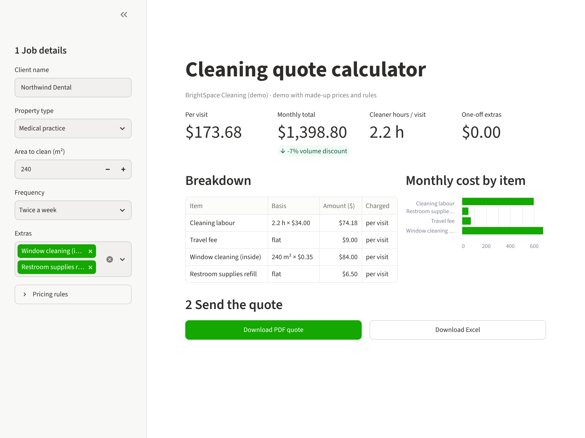

# Quote calculator (demo)

A pricing spreadsheet turned into a small web tool. A fictional cleaning company enters the job details and gets an instant quote with a cost breakdown, a chart, a PDF quote and an Excel export.

**Try it in your browser:** https://dataphil.dev/demo/quote-calculator/ (no install, first load takes 20–40 seconds)



All company names, prices and rules are made up.

## What it shows

- Pricing rules from a spreadsheet moved into readable Python (top of `app.py`): productivity per property type, visit frequency, extras, minimum charge, volume discount
- Live recalculation as inputs change
- PDF quote and Excel breakdown at the click of a button
- Runs locally on one computer. No server, no data leaves the machine

In a real project the rules come from the client's existing Excel file and are checked against past quotes before go-live.

## Run it locally

Windows: double-click `start-windows.bat`
Mac / Linux: double-click `start-mac-linux.command` (Mac: right-click > Open the first time)

The first start installs everything automatically with [uv](https://docs.astral.sh/uv/) (1–2 minutes). The tool then opens at http://localhost:8501.

Or with Python 3.10+:

```bash
pip install -r requirements.txt
streamlit run app.py
```

## Files

| File | Purpose |
|---|---|
| `app.py` | The tool (Streamlit). Pricing rules at the top |
| `requirements.txt` | Python packages |
| `.streamlit/config.toml` | Colours and settings |
| `docs/index.html` | Browser version (runs Python in the browser with [stlite](https://github.com/whitphx/stlite)) |

## About

Built by DataPhil: Excel and CSV work automated in Python, and data analysed with sound statistics. MIT licence.
